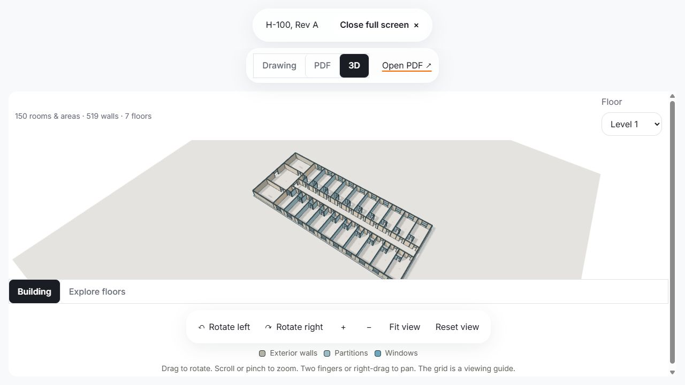
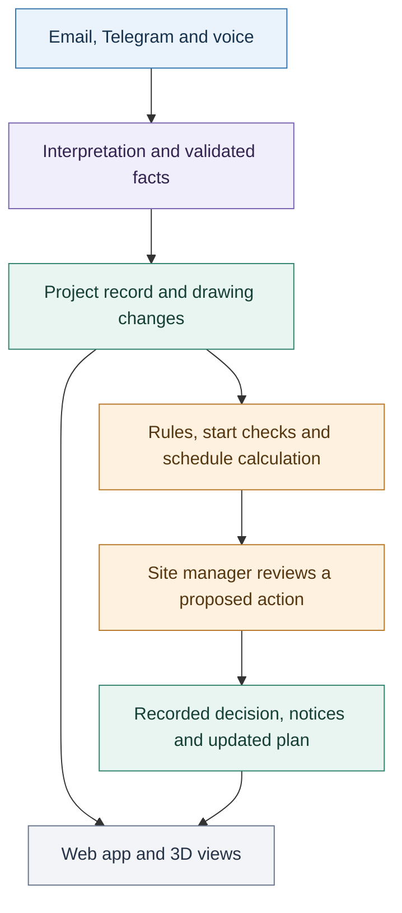

# Aurora for Talona

Aurora connects construction-site conversations to the drawings, work and decisions they affect.

A revised drawing arrives by email. A foreman sends a voice note saying the crew is about to use the previous revision. A supplier moves a delivery by two days. Each message makes sense on its own; the problem is keeping everyone working from the same information. Aurora brings those updates into one project and puts the evidence beside the next decision.

## What it does

- Imports a project with its drawings, room identifiers, teams and construction programme, then asks for a review before saving it.
- Connects incoming email and Telegram messages to the project. Voice notes pass through transcription and read-back confirmation.
- Compares drawing revisions and flags work planned against an outdated drawing, missing inspection sign-offs and reported resource deviations.
- Calculates downstream schedule changes from task dependencies. A person reviews the proposal before adopting new dates.
- Gives people and simulated equipment a start check with the reasons and source messages behind the answer.
- Keeps notifications, confirmations and decisions accessible from the same record, with daily reports and a project timeline.

The building view can show the complete model or one floor, with rotation, zoom and full-screen controls. It uses supplied structured geometry; the original PDFs remain available alongside it.

## Start locally

Install Docker and copy `.env.example` to `.env`. From the repository root, run:

docker build -t talona-aurora .

docker run --rm -p 8000:8000 -e PORT=8000 --env-file .env -v talona-aurora-data:/data talona-aurora

Open [localhost:8000](http://localhost:8000). The named volume preserves projects and their records between container runs. [The health endpoint](http://localhost:8000/health) reports which modules and external services are simulated.

The bundled baseline uses recorded model responses and simulated external services, so it can be explored without credentials. New project analysis and arbitrary new messages need a configured live model when no matching recording exists. Email, Telegram and voice services each have their own configuration switch. [Demo setup](docs/DEMO.md#live-service-configuration) explains the difference.

## Follow the hotel example

The [demo walkthrough](docs/DEMO.md) includes a fictional 120-room hotel, the import files, exact messages to send and the results to look for. It covers project creation, a changed wall, a Telegram voice note, a human hold and a delayed delivery. It also explains where the less visible features live in the interface.

The PDFs hold the drawings. The accompanying project JSON supplies the geometry, teams, initial delivery dates and task dependencies. Those inputs are explicit so the demonstration can be understood and repeated.

## How the parts fit

The useful boundary is between interpretation and execution. The language model reads the message; code calculates the schedule and checks project constraints. A proposal, a decision and a delivery receipt are separate records, so they can be inspected separately. Explicitly granted automatic holds are the exception to manual review, with their own scope and revocation controls.

See [Architecture](docs/ARCHITECTURE.md) for the implementation, [Feature map](docs/FEATURE_MAP.md) for the Mermaid diagrams and linked capability inventory, and [Demo](docs/DEMO.md) for the product flow. Adaption was used to expand synthetic construction-message examples for the prepared history and evaluation work; it is separate from the live message-processing path.

## Development

The backend uses Python 3.12, FastAPI, Pydantic and SQLite. The frontend uses React, TypeScript, Vite and Three.js. With uv and pnpm installed:

pnpm -C frontend install --frozen-lockfile

pnpm -C frontend build

uv run --python 3.12 --directory backend python -m app.core.main

The backend serves the built frontend and API on the same port. Runtime state is written under `DATA_DIR`, or `.local` when that variable is unset. Keep credentials in the ignored `.env` file or deployment environment.

## Demonstration scope

The hotel, programme and crew role are synthetic. The recorded hotel run used real email and Telegram transport, while the layout robot and survey drone were simulated. A local clone starts with simulated services until configured otherwise. The drone scene demonstrates a refused start check because the selected room has no unambiguous survey task.

This is a working prototype for a supervised site workflow. Its records support a person's decision; they are not certification of a drawing, an inspection or physical work. The current application needs access control and operational hardening before use with real project data beyond a controlled demonstration.

## Rights

Built for Talona. No open-source licence is granted.
