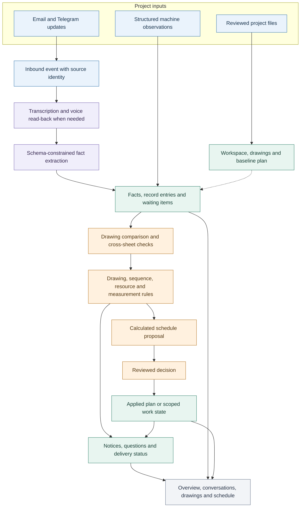

# Architecture

Aurora is built around a project record rather than a chat transcript. Messages are useful inputs, but drawings, tasks, confirmations and decisions need identities that survive beyond a conversation. That choice lets the web app, channel adapters and machine interfaces ask about the same room and the same piece of work.

The implementation is a modular Python application with a React frontend. One FastAPI process serves the HTTP API and the built UI. SQLite holds JSON documents, while uploaded sources and generated drawing assets live on disk beneath `DATA_DIR`. The Docker image builds the frontend separately and packages the result with the backend.

This keeps the demonstration easy to run and inspect. The domain boundaries are explicit without requiring a separate network service for every step. It is a practical prototype layout, with clear places to extend channel delivery, scheduling or persistence when operational requirements grow.

## From a message to an action

Solid arrows show the main processing relationships. The dotted arrow indicates shared project context, not a claim that importing a file triggers the complete message pipeline. There are additional paths for questions, clarifications and authorised automatic holds.

The ordering lives in [core/pipeline.py](../backend/app/core/pipeline.py). Each step delegates content to a domain module. This is a useful separation: the pipeline makes processing order visible, while a drawing rule does not also have to know how to poll an inbox or render a page.

## Project setup and scope

[workspace/importer.py](../backend/app/workspace/importer.py) accepts structured project inputs or a model-produced proposal from source text. A structured import is validated before review. Tasks must reference rooms and teams in that project, dates must include time zones, drawing identifiers must agree, and task dependencies must exist without cycles. Description-derived dimensions or dates are presented as assumptions.

For supplied structured data, the model provides a review and may propose equipment. It does not replace the supplied geometry, dates or tasks. The user reviews the draft before the workspace is created. Original source files are retained with the imported project.

[workspace/api.py](../backend/app/workspace/api.py) selects project context for requests. The UI sends `X-Aurora-Project`; GET APIs can also accept a `project` query parameter. A workspace catalog tracks projects, and imported projects use separate directories and stores. Response media links are scoped to the selected project. Deletion is recoverable through the project catalog.

Telegram and email have explicit project bindings in [workspace/channels.py](../backend/app/workspace/channels.py). Incoming shared-account messages follow those bindings rather than whichever project happens to be open in a browser. Binding a new demonstration project deliberately moves the shared accounts. This is one configured inbox and group routed to a project, not a mailbox provisioned for every workspace.

Project selection is a data-routing boundary, not user authentication. The prototype needs an authenticated access layer and appropriate permissions before exposing real project records to a wider audience.

## Interpretation and validation

[core/llm.py](../backend/app/core/llm.py) is the common model adapter. It sends a strict JSON schema with each completion request and classifies failures such as timeouts, HTTP errors, invalid JSON and truncated responses. Domain code validates the returned structures before using them. Extraction can attempt a targeted repair; an unclear message can remain explicitly not understood and enter the clarification flow.

The model's role is to interpret site language: which team is speaking, what room is named, which revision is mentioned, or whether a sentence reports a delay. The schedule graph and start-check rules remain in code. That boundary makes the resulting dates and permission reasons easier to inspect than a free-form model answer would be.

Voice notes add another review boundary. [voicecheck](../backend/app/voicecheck) records a read-back before the transcript becomes an actionable update. Confirming the transcription and confirming adoption of a drawing revision are separate actions. Photos of drawing title blocks use [titleblock](../backend/app/titleblock) to identify sheet and revision information; PDF comparison can still run without structured geometry, but that does not create an accurate 3D model from the PDF.

## Rules and schedule calculation

The rule modules check different kinds of inconsistency:

| Module | Responsibility |
|---|---|
| [rules_drawings](../backend/app/rules_drawings) | Work announced on a superseded revision and changes still awaiting confirmation |
| [rules_sequence](../backend/app/rules_sequence) | Work that requires an inspection which has not been signed off |
| [rules_resources](../backend/app/rules_resources) | Reported deliveries or equipment that differ from the plan |
| [machinereport](../backend/app/machinereport) | Measured machine or sensor reports and the issues they justify |

Flags carry their source evidence. Reconciliation can update a flag after new confirmation arrives without silently clearing a human hold. A standing rule can cover a similar case without producing the same unresolved issue repeatedly.

[schedule/real.py](../backend/app/schedule/real.py) orders tasks by dependency and moves successors that would otherwise start before their predecessors finish. It preserves task durations, applies its working-time rules and returns old and new dates in a proposal. It rejects unknown dependencies, cycles and a proposal whose original dates no longer match the current plan. When evidence changes, the pipeline can replace a pending calculated proposal, giving the refreshed version a distinct identity.

This is dependency-based impact calculation, not a full construction-resource optimiser. A sensible result depends on the quality of the imported task graph. It does not infer every real-world crew, procurement or access constraint that a planner has not supplied.

## Decisions and machine permissions

A proposed action is not a completed action. The decision path stores the chosen action and its reason, applies supported consequences and produces the relevant communication. Holds, releases and plan changes retain their links to the issue they address.

Automatic holds require an explicit authorisation with a scope and controls to revoke it. The [autonomy module](../backend/app/autonomy) records applications of that permission. It is not a general permission for the model to release work, dismiss issues or change the programme without review.

[gate/real.py](../backend/app/gate/real.py) answers whether a specific task may start. It reads holds, drawing confirmations, inspection evidence, resources, dependencies and relevant occupied-unit reports. It returns `yes`, `no` or `unknown` with reasons. The answer is scoped to the task: a human framing hold and a robot layout task are not interchangeable. A check is recorded through the API; it does not itself start equipment or resolve an issue.

The browser simulations for the [layout robot](../frontend/src/pages/robot) and [survey drone](../frontend/src/pages/drone) consume that project context. [Equipment](../frontend/src/pages/machines) shows registered machines and checks. [The MCP interface](../integrations/mcp/server.py) offers site-state, open-issue and waiting-list queries plus a start-check tool. The latter records a check; describing every tool as having no writes would be inaccurate.

## Persistence and delivery

[core/store.py](../backend/app/core/store.py) stores JSON documents in SQLite collections. Events, facts, record entries, waiting items, flags, comparisons, proposals, decisions and outgoing messages have separate identities. Stable incoming event IDs provide duplicate detection. A process-level re-entrant lock serialises ingestion and decisions, reducing conflicting writes within this single-process deployment.

The store commits document operations individually. It is not a transaction spanning the whole pipeline, an immutable event-sourcing system or a guarantee of exactly-once external delivery. Failed processing removes the incoming event's duplicate marker so it can be offered again; some downstream effects may already have been written. Those limits matter when extending the prototype to multiple workers or stronger recovery requirements.

Outgoing messages distinguish queued, sent, failed and simulated states. Email is read over IMAP and sent over SMTP. The email adapter only marks a message read after ingestion succeeds. Telegram supports a shared-secret webhook check when configured. External services are simulated by default and require explicit switches for live operation.

These choices make the record useful for explaining what happened: an intended notice is distinguishable from a successful send, and a send is distinguishable from a crew acknowledgement. They do not replace transport-level monitoring or a durable delivery queue for production use.

## Frontend and observability

React pages use a shared typed API client and project context. The main navigation groups the overview, conversations, drawings and schedule. Details link back to source messages, drawing changes, issue evidence and proposals.

Processing activity shows transcription, extraction, record updates, rules and delivery as separate stages. The UI can show a waiting confirmation or a failed stage instead of making an update appear to vanish. Three.js presents the geometry with floor selection, before/after overlays and shared view controls. WebGL failures can fall back to the available drawing views.

Some detail routes depend on data. **Proof of notice** needs a drawing change, and **rework evidence** needs work reported before that change. QR labels exist before a comparison, but the current register does not expose their link at that point. The [walkthrough](DEMO.md#printed-plan-qr-labels) documents the direct route and current multi-project limitation.

## Adaption and evaluation data

Adaption was used for synthetic dataset augmentation, separate from live project processing. [generate.py](../adaption/generate.py) builds prompt/completion source rows, uploads a source dataset, obtains a generation estimate, requests similar rows and downloads the result. The repository contains 60 source rows and 298 rows in the downloaded augmentation output. [curate.py](../adaption/curate.py) maps relevant routine construction messages back to the baseline project's identifiers and produces a 72-message history over five preceding days.

The curation is deliberate: generated rows can describe unrelated projects or topics. Routine history is filtered so it does not quietly introduce the drawing changes, delivery conflicts or inspection claims reserved for the demonstration. [check.py](../adaption/check.py) contains checks for project references, coverage and the history's effect on the scenario. The [autonomy evaluation](../eval/autonomy/run.py) replays that history through the message pipeline.

These artefacts document an actual use of Adaption to expand example data. They do not represent fine-tuned model weights, real site communications or proof that live interpretation improved by a measured percentage. The imported hotel is a separate dataset from this baseline history, and the Docker runtime does not require the Adaption SDK.

The [eval directory](../eval) also contains extraction, question-answering, instruction, pipeline, stress and voice evaluation tools and saved reports. Reports identify their scenario and execution mode; recorded-answer replay and live model evaluation should be interpreted separately. Historical report totals are not a claim that every path in the current application was rerun against every provider.

## Repository guide

| Location | What to read there |
|---|---|
| [backend/app/core](../backend/app/core) | HTTP routes, shared models, module selection, processing order, model access and storage |
| [backend/app/workspace](../backend/app/workspace) | Project imports, geometry validation, source files and channel routing |
| [backend/app](../backend/app) | Drawing, record, rule, schedule, channel, reporting and permission modules |
| [frontend/src](../frontend/src) | Pages, navigation, typed requests and 3D presentation |
| [contracts/openapi.json](../contracts/openapi.json) | Checked-in core API description; workspace additions are also defined directly in their route module |
| [data](../data) and [mocks](../mocks) | Bundled baseline sources and deterministic external-service fixtures |
| [adaption](../adaption) and [eval](../eval) | Synthetic-message preparation and evaluation artefacts |
| [integrations/mcp](../integrations/mcp) | The site-context tool interface |

The [feature map](FEATURE_MAP.md) connects the product capabilities to these implementation locations. It distinguishes code that is present from services that require credentials, features that need particular evidence, and physical operations which are only simulated here.
