# Feature map

This map follows the product implementation in this repository. The overview shows the working flow; the detailed diagrams keep the individual capabilities readable rather than putting more than a hundred boxes on one canvas. Each feature links to its implementation, and the inventory below each diagram states what is needed to use it.

The supplied atlas contained 110 entries. This version maps 109 of those entries to code in the public repository and adds 12 capabilities from the newer project experience and data preparation. The former standalone chat-export audit is excluded because its implementation is not shipped here. The old QR deployment utility is also absent, but its user-facing behaviour is implemented by the current label URL helper and frontend build setting.

The inventory is a source-level check of implementation and integration points, not a claim that every feature was rerun against a live service. A configured channel, a simulated machine and a view awaiting evidence are different states. There is no blanket completion percentage.

## The working flow

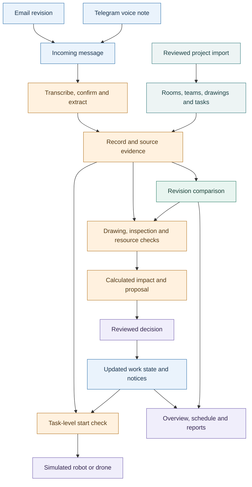

Solid arrows above show data or decision flow. In the detailed diagrams below, dotted lines only group related capabilities for reading. They do not assert that every connected feature must execute before the next one. The reference codes provide a stable way to match entries to the supplied atlas; W references identify newer additions.

## Reading availability

- **Implemented:** the view or module is present; it still uses the selected project's data.
- **Relevant evidence / state:** the feature becomes meaningful after a message, change, decision or proposal exists.
- **Configuration / external service:** credentials, routing or an optional service are required for the live path.
- **Simulation / structured observation:** equipment is simulated, or an API accepts measured fields; physical hardware is not supplied.

The [demo walkthrough](DEMO.md#finding-the-other-views) gives the exact English navigation labels. The [architecture](ARCHITECTURE.md) explains the boundaries between interpretation, calculation and execution.

## Project setup, import and example data

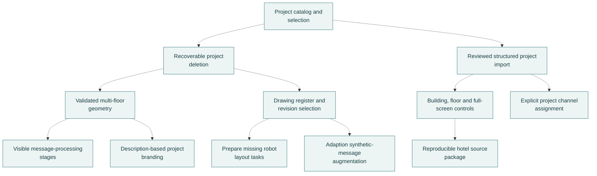

| Ref | Capability | Implementation | Availability |
|---|---|---|---|
| W01 | Project catalog and selection | [index.tsx](../frontend/src/pages/projects/index.tsx) | Implemented |
| W02 | Recoverable project deletion | [storage.py](../backend/app/workspace/storage.py) | Implemented |
| W03 | Reviewed structured project import | [importer.py](../backend/app/workspace/importer.py) | Live setup model for new analysis |
| W04 | Validated multi-floor geometry | [geometry.py](../backend/app/workspace/geometry.py) | Supplied geometry or reviewed assumptions |
| W05 | Drawing register and revision selection | [Drawings.tsx](../frontend/src/pages/drawings/Drawings.tsx) | Implemented |
| W06 | Building, floor and full-screen controls | [GeometryView.tsx](../frontend/src/pages/drawings/GeometryView.tsx) | Geometry and WebGL |
| W07 | Explicit project channel assignment | [channels.py](../backend/app/workspace/channels.py) | Configured email / Telegram accounts |
| W08 | Visible message-processing stages | [Activity.tsx](../frontend/src/pages/overview/Activity.tsx) | Incoming processing activity |
| W09 | Description-based project branding | [branding.py](../backend/app/workspace/branding.py) | Configured setup model |
| W10 | Prepare missing robot layout tasks | [robot_programme.py](../backend/app/workspace/robot_programme.py) | Imported project and live setup model |
| W11 | Adaption synthetic-message augmentation | [generate.py](../adaption/generate.py) | Offline data preparation; service key to regenerate |
| W12 | Reproducible hotel source package | [Aurora_Project_EN.json](../docs/demo-data/Aurora_Project_EN.json) | Synthetic example |

## Communication · 1

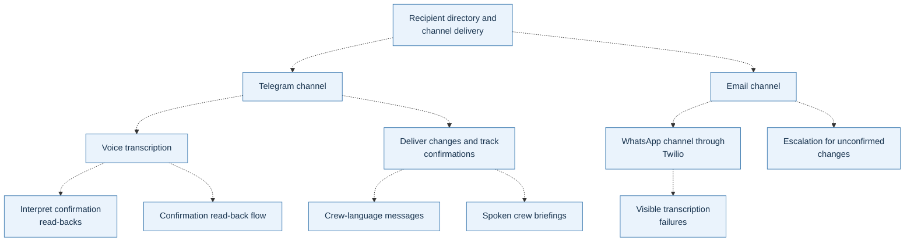

| Ref | Capability | Implementation | Availability |
|---|---|---|---|
| F49 | Recipient directory and channel delivery | [live](../backend/app/live) | Configuration / external service |
| F18 | Telegram channel | [telegram](../backend/app/telegram) | Configuration / external service |
| F19 | Email channel | [email](../backend/app/email) | Configuration / external service |
| F20 | Voice transcription | [voice](../backend/app/voice) | Configuration / external service |
| F22 | Deliver changes and track confirmations | [outbox](../backend/app/outbox) | Relevant project evidence / state |
| F30 | WhatsApp channel through Twilio | [whatsapp](../backend/app/whatsapp) | Configuration / external service |
| F58 | Escalation for unconfirmed changes | [outbox](../backend/app/outbox) | Configuration / external service |
| F59 | Interpret confirmation read-backs | [readback](../backend/app/readback) | Configuration / external service |
| F60 | Confirmation read-back flow | [outbox](../backend/app/outbox) | Configuration / external service |
| F61 | Crew-language messages | [language](../backend/app/language) | Configuration / external service |
| F78 | Spoken crew briefings | [speech](../backend/app/speech) | Configuration / external service |
| F89 | Visible transcription failures | [voice](../backend/app/voice) | Relevant project evidence / state |

## Communication · 2

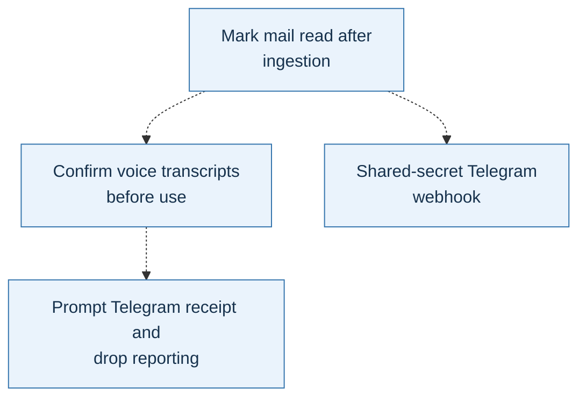

| Ref | Capability | Implementation | Availability |
|---|---|---|---|
| F91 | Mark mail read after ingestion | [email](../backend/app/email) | Implemented |
| F121 | Confirm voice transcripts before use | [voicecheck](../backend/app/voicecheck) | Relevant project evidence / state |
| F151 | Shared-secret Telegram webhook | [telegram](../backend/app/telegram) | Secret must be configured |
| F181 | Prompt Telegram receipt and drop reporting | [telegram](../backend/app/telegram) | Configuration / external service |

## Drawing evidence

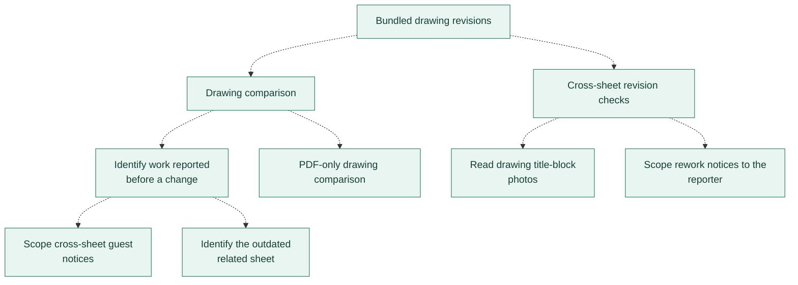

| Ref | Capability | Implementation | Availability |
|---|---|---|---|
| F03 | Bundled drawing revisions | [drawings](../data/drawings) | Implemented |
| F08 | Drawing comparison | [drawings](../backend/app/drawings) | Relevant project evidence / state |
| F80 | Cross-sheet revision checks | [crosscheck](../backend/app/crosscheck) | Relevant project evidence / state |
| F102 | Identify work reported before a change | [rework](../backend/app/rework) | Relevant project evidence / state |
| F104 | PDF-only drawing comparison | [pdfdiff](../backend/app/pdfdiff) | Relevant project evidence / state |
| F107 | Read drawing title-block photos | [titleblock](../backend/app/titleblock) | Configuration / external service |
| F114 | Scope rework notices to the reporter | [rework](../backend/app/rework) | Relevant project evidence / state |
| F155 | Scope cross-sheet guest notices | [crosscheck](../backend/app/crosscheck) | Relevant project evidence / state |
| F177 | Identify the outdated related sheet | [crosscheck](../backend/app/crosscheck) | Relevant project evidence / state |

## Interpretation, rules and project context · 1

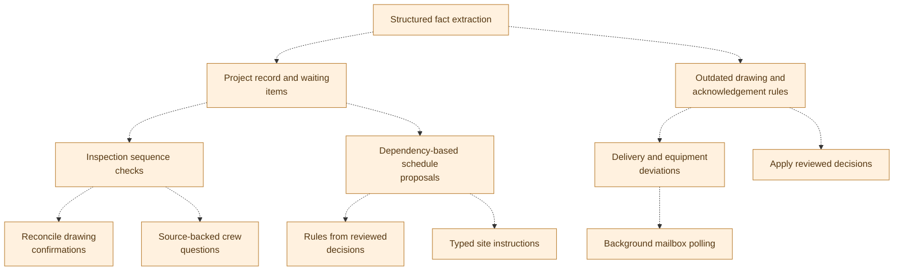

| Ref | Capability | Implementation | Availability |
|---|---|---|---|
| F06 | Structured fact extraction | [extract](../backend/app/extract) | Implemented |
| F07 | Project record and waiting items | [record](../backend/app/record) | Implemented |
| F09 | Outdated drawing and acknowledgement rules | [rules_drawings](../backend/app/rules_drawings) | Relevant project evidence / state |
| F10 | Inspection sequence checks | [rules_sequence](../backend/app/rules_sequence) | Relevant project evidence / state |
| F12 | Dependency-based schedule proposals | [schedule](../backend/app/schedule) | Relevant project evidence / state |
| F11 | Delivery and equipment deviations | [rules_resources](../backend/app/rules_resources) | Relevant project evidence / state |
| F13 | Apply reviewed decisions | [decisions](../backend/app/decisions) | Relevant project evidence / state |
| F52 | Reconcile drawing confirmations | [rules_drawings](../backend/app/rules_drawings) | Relevant project evidence / state |
| F23 | Source-backed crew questions | [qa](../backend/app/qa) | Relevant project evidence / state |
| F25 | Rules from reviewed decisions | [learning](../backend/app/learning) | Relevant project evidence / state |
| F24 | Typed site instructions | [command](../backend/app/command) | Relevant project evidence / state |
| F48 | Background mailbox polling | [core](../backend/app/core) | Configuration / external service |

## Interpretation, rules and project context · 2

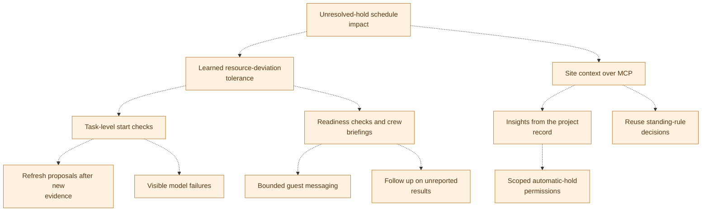

| Ref | Capability | Implementation | Availability |
|---|---|---|---|
| F62 | Unresolved-hold schedule impact | [schedule](../backend/app/schedule) | Relevant project evidence / state |
| F64 | Learned resource-deviation tolerance | [rules_resources](../backend/app/rules_resources) | Relevant project evidence / state |
| F65 | Site context over MCP | [mcp](../integrations/mcp) | Configuration / external service |
| F67 | Task-level start checks | [gate](../backend/app/gate) | Implemented |
| F68 | Readiness checks and crew briefings | [readiness](../backend/app/readiness) | Configuration / external service |
| F69 | Insights from the project record | [insights](../backend/app/insights) | Relevant project evidence / state |
| F71 | Reuse standing-rule decisions | [rules_sequence](../backend/app/rules_sequence) | Relevant project evidence / state |
| F72 | Refresh proposals after new evidence | [core](../backend/app/core) | Relevant project evidence / state |
| F74 | Visible model failures | [qa](../backend/app/qa) | Relevant project evidence / state |
| F77 | Bounded guest messaging | [guest](../backend/app/guest) | Configuration / external service |
| F79 | Follow up on unreported results | [followup](../backend/app/followup) | Relevant project evidence / state |
| F83 | Scoped automatic-hold permissions | [autonomy](../backend/app/autonomy) | Relevant project evidence / state |

## Interpretation, rules and project context · 3

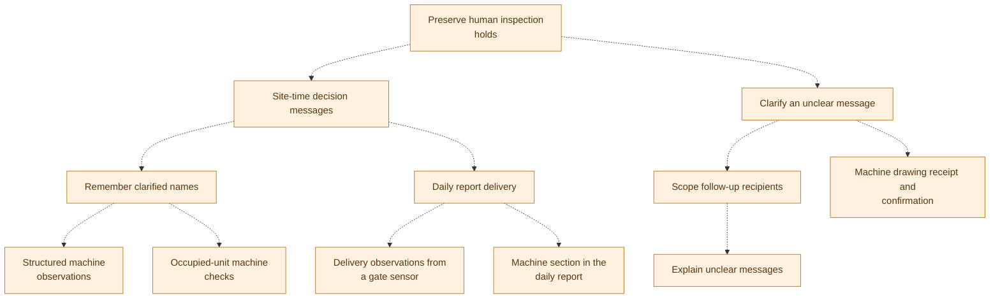

| Ref | Capability | Implementation | Availability |
|---|---|---|---|
| F88 | Preserve human inspection holds | [rules_sequence](../backend/app/rules_sequence) | Relevant project evidence / state |
| F90 | Site-time decision messages | [decisions](../backend/app/decisions) | Relevant project evidence / state |
| F95 | Clarify an unclear message | [clarify](../backend/app/clarify) | Relevant project evidence / state |
| F96 | Remember clarified names | [names](../backend/app/names) | Relevant project evidence / state |
| F101 | Daily report delivery | [dailyreport](../backend/app/dailyreport) | Configuration / external service |
| F113 | Scope follow-up recipients | [followup](../backend/app/followup) | Relevant project evidence / state |
| F143 | Machine drawing receipt and confirmation | [machine](../backend/app/machine) | Simulation / structured observation |
| F144 | Structured machine observations | [machinereport](../backend/app/machinereport) | Simulation / structured observation |
| F161 | Occupied-unit machine checks | [gate](../backend/app/gate) | Relevant project evidence / state |
| F162 | Delivery observations from a gate sensor | [machinereport](../backend/app/machinereport) | Simulation / structured observation |
| F163 | Machine section in the daily report | [dailyreport](../backend/app/dailyreport) | Relevant project evidence / state |
| F86 | Explain unclear messages | [record](../backend/app/record) | Relevant project evidence / state |

## Interpretation, rules and project context · 4

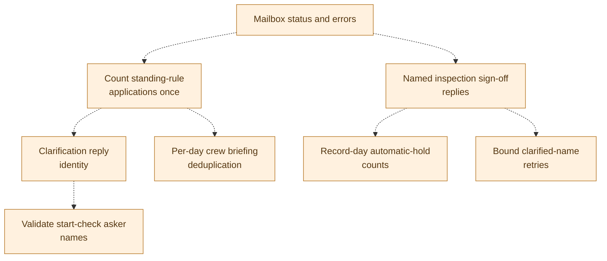

| Ref | Capability | Implementation | Availability |
|---|---|---|---|
| F112 | Mailbox status and errors | [core](../backend/app/core) | Relevant project evidence / state |
| F133 | Count standing-rule applications once | [insights](../backend/app/insights) | Relevant project evidence / state |
| F152 | Named inspection sign-off replies | [followup](../backend/app/followup) | Relevant project evidence / state |
| F153 | Clarification reply identity | [clarify](../backend/app/clarify) | Relevant project evidence / state |
| F154 | Per-day crew briefing deduplication | [readiness](../backend/app/readiness) | Configuration / external service |
| F173 | Record-day automatic-hold counts | [autonomy](../backend/app/autonomy) | Relevant project evidence / state |
| F178 | Bound clarified-name retries | [names](../backend/app/names) | Relevant project evidence / state |
| F179 | Validate start-check asker names | [gate](../backend/app/gate) | Relevant project evidence / state |

## Product views and interaction · 1

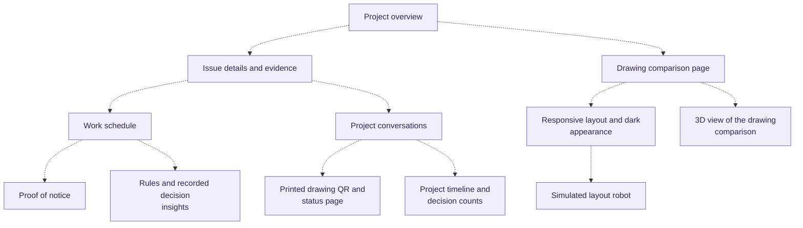

| Ref | Capability | Implementation | Availability |
|---|---|---|---|
| F14 | Project overview | [overview](../frontend/src/pages/overview) | Implemented |
| F15 | Issue details and evidence | [flag](../frontend/src/pages/flag) | Implemented |
| F16 | Drawing comparison page | [compare](../frontend/src/pages/compare) | Relevant project evidence / state |
| F17 | Work schedule | [plan](../frontend/src/pages/plan) | Implemented |
| F31 | Project conversations | [crew](../frontend/src/pages/crew) | Implemented |
| F32 | Responsive layout and dark appearance | [styles](../frontend/src/styles) | Implemented |
| F46 | 3D view of the drawing comparison | [compare3d](../frontend/src/pages/compare3d) | Relevant project evidence / state |
| F63 | Proof of notice | [notice](../frontend/src/pages/notice) | Relevant project evidence / state |
| F70 | Rules and recorded decision insights | [learned](../frontend/src/pages/learned) | Relevant project evidence / state |
| F75 | Printed drawing QR and status page | [sheet](../frontend/src/pages/sheet) | Direct route; navigation depends on comparison |
| F76 | Project timeline and decision counts | [timelapse](../frontend/src/pages/timelapse) | Implemented |
| F81 | Simulated layout robot | [robot](../frontend/src/pages/robot) | Simulation / structured observation |

## Product views and interaction · 2

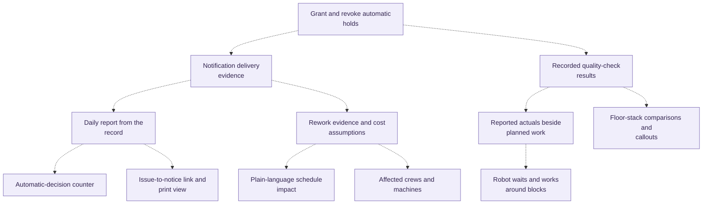

| Ref | Capability | Implementation | Availability |
|---|---|---|---|
| F84 | Grant and revoke automatic holds | [autonomy](../frontend/src/pages/autonomy) | Relevant project evidence / state |
| F94 | Notification delivery evidence | [notice](../frontend/src/pages/notice) | Relevant project evidence / state |
| F99 | Recorded quality-check results | [evaluation](../frontend/src/pages/evaluation) | Implemented |
| F100 | Daily report from the record | [daily](../frontend/src/pages/daily) | Implemented |
| F103 | Rework evidence and cost assumptions | [rework](../frontend/src/pages/rework) | Relevant project evidence / state |
| F108 | Reported actuals beside planned work | [plan](../frontend/src/pages/plan) | Relevant project evidence / state |
| F135 | Floor-stack comparisons and callouts | [compare3d](../frontend/src/pages/compare3d) | Relevant project evidence / state |
| F136 | Automatic-decision counter | [overview](../frontend/src/pages/overview) | Relevant project evidence / state |
| F137 | Issue-to-notice link and print view | [notice](../frontend/src/pages/notice) | Relevant project evidence / state |
| F138 | Plain-language schedule impact | [plan](../frontend/src/pages/plan) | Relevant project evidence / state |
| F140 | Affected crews and machines | [flag](../frontend/src/pages/flag) | Relevant project evidence / state |
| F141 | Robot waits and works around blocks | [robot](../frontend/src/pages/robot) | Simulation / structured observation |

## Product views and interaction · 3

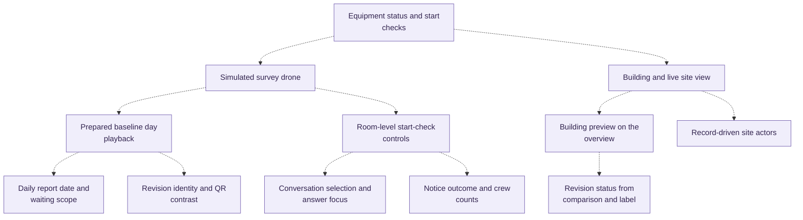

| Ref | Capability | Implementation | Availability |
|---|---|---|---|
| F149 | Equipment status and start checks | [machines](../frontend/src/pages/machines) | Implemented |
| F150 | Simulated survey drone | [drone](../frontend/src/pages/drone) | Simulation / structured observation |
| F157 | Building and live site view | [site](../frontend/src/pages/site) | Implemented |
| F159 | Prepared baseline day playback | [siteplay](../frontend/src/pages/siteplay) | Bundled baseline only |
| F160 | Room-level start-check controls | [siteask](../frontend/src/pages/siteask) | Relevant project evidence / state |
| F164 | Building preview on the overview | [overview](../frontend/src/pages/overview) | Relevant project evidence / state |
| F165 | Record-driven site actors | [sitescene](../frontend/src/pages/sitescene) | Simulation / structured observation |
| F145 | Daily report date and waiting scope | [daily](../frontend/src/pages/daily) | Relevant project evidence / state |
| F146 | Revision identity and QR contrast | [sheet](../frontend/src/pages/sheet) | Implemented |
| F170 | Conversation selection and answer focus | [crew](../frontend/src/pages/crew) | Relevant project evidence / state |
| F171 | Notice outcome and crew counts | [notice](../frontend/src/pages/notice) | Relevant project evidence / state |
| F174 | Revision status from comparison and label | [sheet](../frontend/src/pages/sheet) | Relevant project evidence / state |

## Product views and interaction · 4

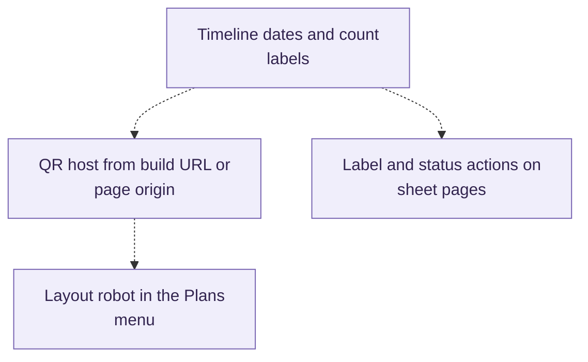

| Ref | Capability | Implementation | Availability |
|---|---|---|---|
| F180 | Timeline dates and count labels | [timelapse](../frontend/src/pages/timelapse) | Relevant project evidence / state |
| F183 | QR host from build URL or page origin | [labelUrl.js](../frontend/src/pages/sheet/labelUrl.js) | Build-time URL or page origin |
| F184 | Label and status actions on sheet pages | [sheet](../frontend/src/pages/sheet) | Relevant project evidence / state |
| F188 | Layout robot in the Plans menu | [components](../frontend/src/components) | Implemented |

## Corrections to the earlier atlas

- The standalone chat-export audit is not part of this repository and is not shown as an available product feature.
- QR labels still exist. Their host comes from `VITE_PUBLIC_URL` or the page origin, not from a shipped deployment helper. The current label omits workspace identity, so a phone must be on the intended project in a multi-project setup.
- Telegram shared-secret validation only applies when a secret is configured. A module existing does not establish a secured live connection.
- The layout robot and survey drone are simulations. The hotel drone example refuses clearance when it cannot identify a matching survey task.
- Prepared-day playback belongs to the bundled baseline. Imported hotel workspaces use incoming messages and currently have no prepared next event.
- The current interface says **Messages**, **Saved rules**, **Quality checks** and **Automation** in navigation; some page headings retain older names.
- Project creation, reviewed imports, channel assignment, a drawing register, visible processing stages and per-floor views are included here even though the older atlas did not capture the newer project flow.
- Adaption is represented as synthetic-data preparation. It is not a required live inference service or evidence of fine-tuning.

Each capability links to the current product implementation so the map can be checked as the application evolves.
